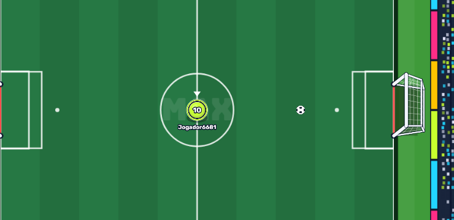

# MAXBALL 1.0.10 — tamanho da bola, área de ação e paredes

- **Bola 2% maior:** raio físico e visual de 8,4 para **8,568**; diâmetro de 16,8 para 17,136. A proporção passa de 42% para 42,84% do diâmetro do personagem, sem aumentar a hitbox separadamente.
- **Área transparente 5% maior no diâmetro:** o personagem tem raio 20 e a área tem raio **21**. O aro discreto fica ao redor do disco e pisca em branco por **180 ms** ao pressionar passe ou chute, inclusive quando a bola está fora de alcance. Segurar o botão não repete a piscada. A animação também é transmitida pelo servidor, com resposta visual imediata para o jogador local.
- **Paredes firmes:** restituição de **0,45 para 0,82**. A componente da velocidade perpendicular à parede volta com 82% do impacto; a componente paralela é preservada, descontado o atrito normal do rolamento. Um impacto forte continua gerando um retorno forte, sem acrescentar energia.
- **Sem segunda inversão:** uma bola fora do limite que já está voltando ao campo é corrigida para dentro sem receber outro rebote.

O raio da área e o alcance do passe/chute usam a mesma função em `src/physics/interaction.js`: a borda física da bola precisa tocar essa área. O alcance normal permanece praticamente igual ao anterior, acrescido apenas do aumento real da bola. O alcance especial do DB continua limitado à continuação do próprio passe, sem colisões intermediárias.

Os parâmetros ficam em `src/core/config.js`. A velocidade do jogador, a saída do passe, a janela de 180 ms do DB e a desaceleração no gramado da versão 1.0.9 foram preservadas. Traves e redes mantêm seus comportamentos próprios. A grama e os cosméticos também foram preservados.

## Verificação

- Suíte completa: **327 testes aprovados, nenhuma falha**. APK 1.0.10 com assinaturas v2/v3 verificadas e 142 arquivos públicos conferidos contra os fontes atuais.
- 55 testes focados aprovados: crescimento proporcional, borda da área, piscada mesmo sem contato, ausência de repetição ao segurar, transmissão por frame/delta, quatro paredes em velocidades 40/150/360/440, conservação da componente tangencial, DB, física, controles e protocolo.
- Navegador com toque em 740×360: área transparente e piscada capturadas no Canvas real; passe e chute fora de alcance não movimentam a bola. Um impacto a velocidade 360 retornou a **282,18**, incluindo o atrito entre o impacto e a leitura no navegador. Evidências em [qa-1.0.10](qa-1.0.10/area-browser.json).
- O DB foi novamente verificado por toque e teclado com intervalo programado de 150 ms; dados em [db-browser.json](qa-1.0.10/db-browser.json).

O protocolo ganhou o campo visual `actionFlash`. Atualize cliente e servidor juntos para o contrato `2026-10-11-wall-area-18`. O APK de teste mantém a configuração local de servidor das versões anteriores.

