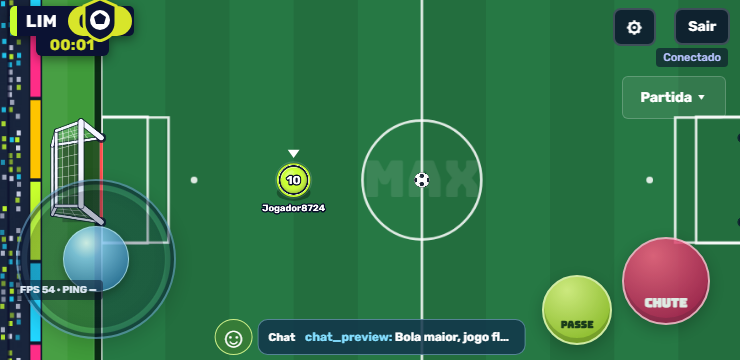
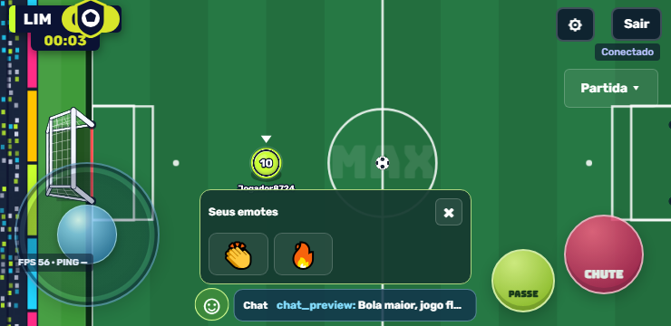

# MAXBALL 1.0.13 — bola maior, chat no rodapé e emotes separados

A bola aumentou mais 6% em relação à 1.0.12: raio de 8,568 para 9,08208. Visual e colisão continuam coerentes. A massa de 1,908, velocidades, desaceleração no gramado, restituição das paredes, área do jogador e janela de DB de 180 ms permanecem iguais. O aumento do raio muda apenas a geometria de contato e a rotação por distância percorrida.

O chat da partida mostra a última mensagem numa faixa discreta no rodapé. O botão Chat (atalho T) abre histórico e campo de texto na parte inferior. Emojis e atalhos de emotes foram removidos desse painel. A faixa fechada não se sobrepõe aos controles padrão nos quatro tamanhos de tela testados. O histórico permite silenciar jogadores e continua tratando mensagens como texto, sem executar HTML.

Um botão próprio ☺ abre os emotes adquiridos, inclusive os que não estão nos quatro atalhos equipados. Ao escolher um, o painel fecha e o emote aparece sobre o personagem durante 2,5 segundos; nenhum texto de emote é inserido no chat. O vestiário local usa o mesmo seletor separado. No treino sem conta, está disponível apenas o aplauso gratuito.

O servidor verifica a posse e a categoria do item antes de transmitir o emote, exige participação em uma equipe e preserva o limite de um uso a cada três segundos. O envio antigo por slot continua compatível. Não é necessário equipar um item apenas para usá-lo pelo seletor.

Verificação:

- `npm test`: 336 testes aprovados, zero falhas, incluindo condução, DB, massa, paredes, posse de emotes, chat e servidor. Após a integração do seletor ao vestiário local, 17 testes de interface/vestiário/jogabilidade passaram novamente; o teste do seletor também verificou o callback local.
- `npm run check`: sintaxe dos 203 arquivos verificada; o novo script de navegador e os arquivos finais alterados também passaram em `node --check`.
- Navegador real: 740×360, 915×412, 568×320 e 1280×720. Envio de mensagem, texto no rodapé, ausência de emotes no chat, inventário com dois emotes, escolha de emote, fechamento por Esc, rota autenticada de envio e ausência de erros JavaScript. Evidências em [qa-1.0.13/browser.json](qa-1.0.13/browser.json).
- DB no navegador real: um passe seguido de um chute, com intervalo de 150 ms, tanto no toque quanto no teclado. Evidências em [qa-1.0.13/db-browser.json](qa-1.0.13/db-browser.json).
- APK 1.0.13 (código 14) compilado, assinaturas v2/v3 verificadas e os 142 arquivos públicos conferidos byte a byte contra o projeto. Ainda sem teste em aparelho físico.

Cliente e servidor usam o contrato `2026-10-11-ball-chat-21` e precisam ser atualizados juntos.

