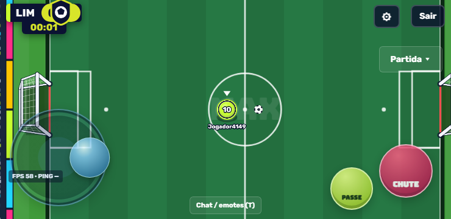

# MAXBALL 1.0.11 — passe e chute durante a condução

## Ajustes solicitados

- Rebote das paredes **9% menor em relação à versão 1.0.10**: restituição de 0,82 para **0,7462**. A componente perpendicular do impacto volta com 74,62% da velocidade; a componente paralela mantém o comportamento anterior.
- Área ao redor do jogador **mais 5% maior**: raio de 21 para **22,05**. O diâmetro da área é 44,1, contra 40 do personagem — 10,25% maior após os dois aumentos consecutivos. A área visual e o alcance físico continuam usando a mesma função.
- Bola, velocidade do jogador, rolamento no gramado, forças de passe/chute, piscada e janela do DB preservados.

## Causa e correção da falha de condução

Antes, a pressão do botão criava uma intenção de passe ou chute válida por apenas 120 ms. Se o jogador segurasse o botão enquanto alcançava a bola, essa intenção expirava antes do contato. O botão continuava pressionado, mas não criava outro comando. Foi reproduzido o caso de aproximação com passe segurado que terminava sem nenhum passe executado.

Agora, uma pressão ainda não executada fica preparada enquanto o botão estiver segurado. Ao alcançar a área, o jogador toca ou chuta uma vez, inclusive se estiver se movendo ou aguardando o cooldown. A pressão é consumida após a execução: segurar não produz chutes repetidos. Soltar e apertar novamente prepara outra ação. Se soltar antes de alcançar a bola, permanece apenas a tolerância curta de 120 ms; a ação não fica pendente indefinidamente.

Quando os dois botões estiverem preparados ao alcançar a bola, a ordem é passe seguido de chute, uma vez. O DB continua com sua janela de 180 ms e cancelamento após uma colisão intermediária. Nenhuma dessas correções prende, reposiciona ou atrai a bola.

## Verificação

- Bateria completa `npm test`: **334 testes aprovados, zero falhas**. `npm run check`: sintaxe dos 202 arquivos verificada.
- 36 testes focados aprovados, incluindo os novos testes de condução, paredes, área de ação, DB e controles.
- Passe/chute preparado antes de chegar à bola em oito direções e duas velocidades de movimento; toque no meio de uma condução contínua; cooldown; soltura; nova pressão; combinação dos dois botões; servidor autoritativo; consistência a 20, 30, 60, 120 e 144 FPS.
- Navegador real em 740×360: passe e chute segurados por 250 ms com a bola distante, seguidos de avanço pelo analógico de toque e pelo teclado. Os quatro casos executaram uma ação corretamente, sem erros JavaScript. Evidências em [qa-1.0.11/carry-browser.json](qa-1.0.11/carry-browser.json).
- DB no navegador real com intervalo de 150 ms entre passe e chute, tanto no toque quanto no teclado: um passe seguido de um chute, sem erros JavaScript. Evidências em [qa-1.0.11/db-browser.json](qa-1.0.11/db-browser.json).
- APK 1.0.11 (código 12) compilado, assinaturas v2/v3 verificadas e todos os 142 arquivos públicos conferidos byte a byte contra o projeto. Não foi realizado teste em aparelho físico.

Parâmetros em `src/core/config.js`, alcance em `src/physics/interaction.js` e tratamento das ações em `src/physics/playerPhysics.js`. Cliente e servidor usam o contrato `2026-10-11-carry-action-19` e devem ser atualizados juntos. O APK de teste mantém a configuração local de servidor das versões anteriores.

