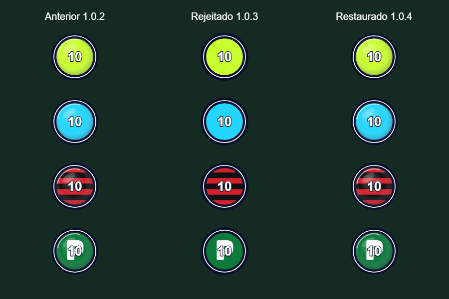
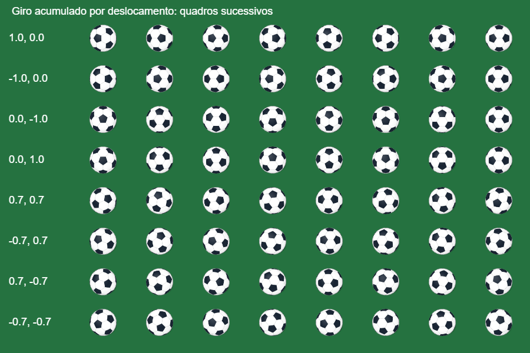

# MAXBALL 1.0.4 — correções por contato

Esta versão segue o pedido mais recente: restauração do acabamento 2.5D dos jogadores, chute e passe pela normal física do contato, menor potência e rotação suave. A descrição da 1.0.3 e seus testes de mira pelo joystick são históricos e não representam mais a regra atual.

## Problemas encontrados

1. **Visual removido:** `drawSkin` e `pSpr` tinham perdido os reflexos, gradientes e detalhes do aro. Seus corpos foram recuperados do commit `51d4664`, sem reverter o projeto. As sombras também voltaram. A comparação no navegador verificou igualdade pixel a pixel dos sprites das 22 skins com a 1.0.2. O tamanho desenhado continua coerente com o raio físico atual.
2. **Direção incompatível com contato:** a 1.0.3 usava a mira do movimento e rejeitava contatos laterais/traseiros. Agora chute e passe usam `normalizar(bola - jogador)`. Ambos preservam uma parcela limitada da velocidade recebida. Um alvo de bot pode escolher a intensidade do passe, mas não substituir a direção de contato. Centros coincidentes aguardam separação em vez de inventar uma direção.
3. **Botão repetindo ação:** o buffer era renovado enquanto o botão permanecia pressionado. Para humanos, agora só um novo pressionamento ou uma nova sequência de ação arma o buffer. Ações autônomas dos bots continuam respeitando cooldown e contato.
4. **Potência excessiva:** o chute de 680 unidades/s percorria 1.369 unidades antes de parar em campo livre. A calibração foi reduzida e medida usando campos reais de 760 a 1.600 unidades de largura.
5. **Contatos e giro:** contatos comuns ficaram mais suaves, com limite de energia definido pelo movimento recebido e pelo empurrão do jogador. O giro anteriormente ignorava o deslocamento contínuo de condução resolvido pelo contato. Esse deslocamento agora contribui para a orientação; a correção de sobreposição parada continua sem gerar giro.

## Parâmetros medidos

| Parâmetro | 1.0.3 | 1.0.4 |
| --- | ---: | ---: |
| Chute padrão | 680 | 360 unidades/s |
| Passe manual padrão | 340 | 190 unidades/s |
| Passe de bot por distância | 170–440 | 140–240 unidades/s |
| Limite absoluto da bola | 816 | 440 unidades/s |
| Retenção de velocidade por segundo | 0,65 | 0,55 |
| Resistência adicional | 12 | 12 unidades/s² |
| Restituição das paredes | 0,65 | 0,45 |
| Restituição das traves | 0,48 | 0,32 |
| Restituição bola/jogador | 0,22 | 0,12 |
| Limite da transferência por condução | 170 | 135 unidades/s |
| Resposta de contato | 24 | 18 por segundo |

Atributos de atletas mantêm seus multiplicadores existentes. A componente normal anterior da bola contribui até ±10% da força da ação; a componente tangencial preserva 20% do valor anterior, limitada a 15% da força. O resultado final ainda respeita o teto de 440. Assim, uma bola parada sai exatamente pela normal, e uma bola em movimento pode produzir um desvio pequeno e limitado, sem ignorar seu movimento nem acumular força indefinidamente.

Sem colisões, o passe manual percorre **138 unidades no primeiro segundo e 239 até parar**; o chute percorre **266 no primeiro segundo e 503 até parar**. No menor campo, isso representa aproximadamente 31% e 66% da largura total. O passe manual não depende mais da intensidade do joystick.

## Arquivos alterados

- `src/legacy/game.js`, `src/ui/matchExperience.js`: restauração visual dos personagens, sombras e contornos.
- `src/physics/playerPhysics.js`: normal de contato comum às duas ações, contribuição limitada de velocidade anterior e uma ação por pressionamento humano.
- `src/core/config.js`: parâmetros de força, atrito, restituição e condução.
- `src/physics/contacts.js`: limite da energia de contato e giro decorrente da condução real.
- `src/ui/ballVisual.js`: resolução angular mais fina no cache de sprites; mantém esfera com pentágonos, orientação acumulada e projeção superior. A renderização não altera posições ou velocidades.
- `index.html`: ordem de carregamento da dependência de rotação utilizada nos contatos.
- `src/ai/tactics.js`, `server/online/penalties.cjs`: posicionamento dos bots para alinhar o contato com o alvo. Necessário porque o alvo não redireciona mais a bola artificialmente.
- `src/core/apiContract.js`: identifica esta versão para que um cliente atualizado detecte um servidor antigo; o protocolo e os sistemas online permanecem iguais.
- Testes, evidências e versão do APK: arquivos de validação e distribuição.

Menus, câmera, cor da grama e regras dos modos de jogo foram preservados.

## Evidências e reprodução

- `node tests/gameplay-calibration.cjs`: gera [576 registros de contato](contact-calibration-1.0.4.json), com entrada, normal, velocidade recebida, velocidade resultante e alinhamento. Inclui comandos perpendiculares/opostos ao contato, bola parada/em movimento e 72 ângulos.
- `node --test tests/contact-controls.test.cjs tests/physics-rebuild.test.cjs`: verifica ações únicas, momento recebido, contato, condução, disputas, desaceleração e rotação, além de passos físicos fixos em seis cadências de renderização.
- `npm.cmd test`: regressões de jogabilidade e funcionalidades existentes.
- `node scripts/qa-contact-browser.cjs`: comparação real de sprites e uso de dois dedos no navegador. Usa Playwright instalado em `.work/browser` e Edge; `MAXBALL_BROWSER` pode indicar outro executável Chromium. [Resultados registrados](qa-1.0.4/browser-results.json).

O teste de toque executou o jogador subindo com a bola à direita. Chute e passe saíram para a direita, enquanto a velocidade vertical do jogador permaneceu negativa. A pequena componente vertical da bola corresponde à normal inclinada produzida pelo deslocamento do disco no instante do contato.

Resultado final: **298 testes aprovados, zero falhas**, e sintaxe verificada em **192 arquivos**. A comparação visual aprovou os sprites das 22 skins; o teste de toque passou para as duas ações, sem erros JavaScript. Os números de FPS nos testes representam cadências de renderização simuladas para verificar consistência física, não desempenho medido em celulares.

APK 1.0.4, código de versão 5: compila com assinatura de depuração v2/v3 verificada. Os 142 arquivos públicos do código-fonte foram comparados byte a byte com o pacote. [Download e SHA-256](../apk/README.md).

Não foi feito teste em aparelho Android físico nem medição comparativa com o Mamoball. As imagens e testes verificam o MAXBALL; não comprovam sensação idêntica à referência. O APK de teste contém modos locais; o servidor online precisa utilizar a versão atual do código para aplicar a mesma física.
