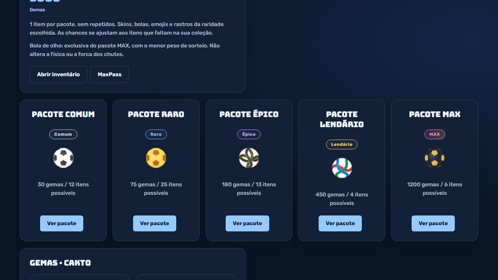
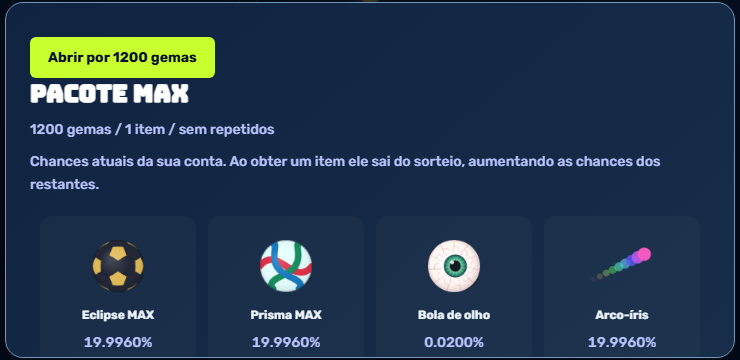
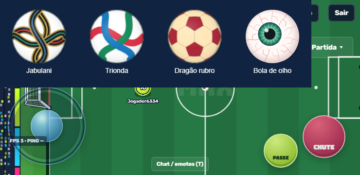
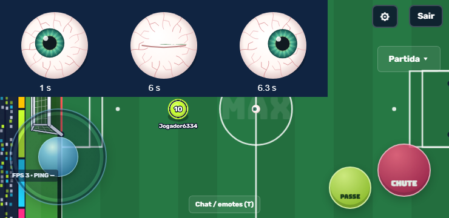

# MAXBALL 1.0.8 — pacotes e skins por gemas

A loja apresenta cinco pacotes. Cada abertura concede um item ainda não adquirido da raridade escolhida: skins prontas, bolas, emojis, comemorações ou rastros, conforme o catálogo disponível.

| Pacote | Preço inicial |
|---|---:|
| Comum | 30 gemas |
| Raro | 75 gemas |
| Épico | 180 gemas |
| Lendário | 450 gemas |
| MAX | 1.200 gemas |

Os preços acompanham o preço-base do comum na administração, com multiplicadores 1 / 2,5 / 6 / 15 / 40 e arredondamento para gemas inteiras. Os dados e multiplicadores iniciais estão em `src/data/collections.js`; o servidor calcula o preço efetivo e o sorteio em `server/services/collections.cjs`.

## Bolas

Foram acrescentadas Treino clássico, Jabulani, Trionda, Aurora, Nebulosa, Dragão rubro, Eclipse MAX, Prisma MAX e Bola de olho. Jabulani e Trionda usam interpretações gráficas simplificadas desenhadas em Canvas, sem texturas externas. Os desenhos acompanham o quaternion físico de rolamento. Referências visuais: [adidas, Trionda](https://news.adidas.com/world-cup-2026/adidas-unveils--trionda----the-official-match-ball-of-the-fifa-world-cup26-/s/27042e3a-12ba-482d-8839-8a96e056b33e) e [adidas, relatório de 2009 com Jabulani](https://res.cloudinary.com/confirmed-web/raw/upload/v1706002505/adidas-group/investors/financial-publications/2009/gb_2009_en_1_i5utcg.pdf).

A Bola de olho é exclusiva do pacote MAX. Ela tem peso 1 contra peso 1.000 dos demais itens. Na coleção inicial com seis itens MAX, a chance é **1/5.001 = aproximadamente 0,0200%**. Ela não está disponível por compra direta, pacotes antigos ou recompensas dos passes. É o item mais raro no sorteio inicial e exige o pacote mais caro.

**Não existem repetidos:** as probabilidades são recalculadas e mostradas antes da abertura. Por isso, a chance do olho aumenta conforme os outros itens MAX são adquiridos; se só faltar ele, a chance é 100%. Com o catálogo inicial inteiro disponível, seis aberturas MAX completam essa coleção. Não há promessa de chance fixa de 0,0200% para todas as contas.

A aparência tem veias, íris com detalhes radiais e pupila que acompanha a posição do jogador local. A piscada acontece a cada seis segundos. No inventário, o olhar acompanha o ponteiro. Essa animação não aplica forças à bola. A física, a velocidade do jogador, o DB e a grama da versão 1.0.7 foram preservados.

## Skins personalizadas

Criar ou copiar uma skin custa **50 gemas**. Editar custa **5 gemas por propriedade efetivamente alterada ao salvar**: nome, cores-base, estilo, propriedades das camadas ou inclusão/remoção de camada. Um traço conta como propriedade de desenho, não por ponto. A comparação usa o estado final; experimentar na prévia, desfazer e salvar sem alterações não cobra gemas.

O editor mostra o preço antes de salvar. Saldo insuficiente mantém a skin e a carteira intactas. Repetir a mesma requisição não duplica a cobrança nem a criação. Aplicar uma skin salva ao clube é gratuito; alterações ainda não salvas não podem ser aplicadas para contornar a cobrança. Uniformes já existentes continuam disponíveis.

## Validação e publicação

- Suíte completa: 320 testes aprovados, nenhuma falha; inclui física, DB, multiplayer, economia e novos pacotes.
- Depois do ajuste de preços administrativos: 17 testes focados aprovados, incluindo preço efetivamente cobrado, sorteio por raridade, exclusividade do olho, idempotência, saldo insuficiente e edição de skins.
- Navegador real com servidor e banco isolados: compra de pacote, criação/edição de skin, inventário, equipar olho e partida, sem erros JavaScript. Layouts 740×360 com toque e 1280×720. Evidências em [qa-1.0.8](qa-1.0.8/browser.json).
- A migration `015_shop_packs.sql` é aplicada automaticamente na inicialização. Ela preserva inventários existentes e mantém as bolas 8–11 exclusivas dos passes.
- Cliente e servidor usam o contrato `2026-10-11-shop-16`; atualize ambos no deploy.

Código enviado ao GitHub não equivale a publicar o servidor. Compras e inventário exigem conta e servidor MAXBALL ativo. O APK local de teste não possui um servidor HTTPS configurado; para usar a loja no APK, compile com `MAXBALL_SERVER_URL` apontando para o servidor publicado, conforme a documentação Android.

